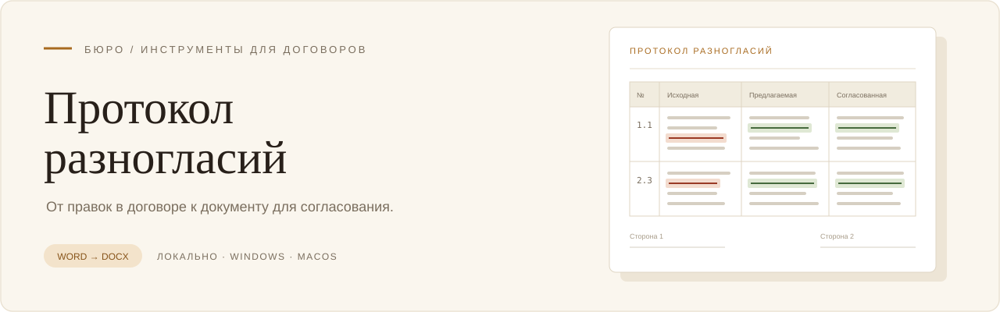

<p align="center">
  
</p>
<p align="center">
  <strong>Превратите правки в договоре Word в протокол разногласий.</strong><br>
  Приложение для юристов на macOS и Windows. Документы обрабатываются на вашем компьютере. Никакого ИИ (уж к сожалению или к счастью сказать не берусь)
</p>


<p align="center">
  <a href="#что-делает-приложение">Возможности</a> ·
  <a href="#установка-на-macos">Установка на Mac</a> ·
  <a href="#установка-на-windows">Установка на Windows</a> ·
  <a href="#как-подготовить-протокол">Как пользоваться</a>
</p>

## Что делает приложение

«Протокол разногласий» помогает подготовить, внезапно, протокол разногласий удобным способом — конвертировав договор с правками в режиме рецензирования (с редлайном) в протокол. Особенно спасает, если вы как обычно поправили договор, а потом оказалось, что контрагент работает только через протоколы разногласий.

Загрузите договор с исправлениями, внесёнными в режиме рецензирования Word: приложение найдёт изменённые пункты и соберёт таблицу с исходной, предлагаемой и согласованной редакциями.

Вместо ручного переноса правок вы получаете основу протокола, которую можно проверить и отредактировать перед финализацией.

- **Сравнивайте редакции.** Просматривайте разногласия по пунктам с подсветкой различий или в общей таблице.
- **Готовьте согласованный текст.** Редактируйте формулировки, добавляйте строки, объединяйте соседние пункты и исключайте лишнее.
- **Контролируйте полноту.** Приложение показывает замечания обработки и помогает заметить правки, не вошедшие в протокол. Отмечайте проверенные пункты, чтобы не терять место в работе.
- **Настраивайте оформление.** Укажите стороны, реквизиты договора, дату и место составления, шапку, названия колонок, заключительные положения и данные подписантов.
- **Сохраняйте документ Word.** На выходе — редактируемый `.docx` с таблицей из четырёх колонок: пункт договора, две редакции сторон и согласованная редакция. Формат — A4, альбомная ориентация.
- **Возвращайтесь к работе позже.** Откройте договор из списка «Недавние документы» и продолжите подготовку протокола.

Для обработки договора и сохранения протокола не нужны интернет или установленный Microsoft Word.

## Перед началом работы

Нужен договор в формате **`.docx` с сохранёнными исправлениями в режиме рецензирования Word**. Не принимайте все исправления перед загрузкой: приложению нужны обе редакции текста.

Приложение извлекает уже внесённые правки из одного файла. Для сравнения двух отдельных версий договора сначала воспользуйтесь сравнением документов в Word и сохраните результат с исправлениями.

Поддерживаются текстовые вставки, удаления и перемещения, а также вставки и удаления строк и ячеек таблиц. Старый формат `.doc`, PDF и документы с макросами не подходят. Максимальный размер файла — **25 МиБ** (26 214 400 байт). Вложенные таблицы и исправления объединения ячеек требуют предварительной обработки в Word; приложение сообщает о таких ограничениях.

**Перед отправкой контрагенту проверьте итоговый протокол.** Автоматическая проверка помогает контролировать наличие правок, а оценка формулировок и юридических последствий остаётся за вами.

## Установка на macOS

> **Приложение не имеет подписи, подтверждающей издателя, и не прошло проверку Apple (нотариализацию).** macOS может заблокировать первый запуск или показать сообщение, что разработчика нельзя проверить либо приложение повреждено. Используйте установщик из доверенного источника. Команда ниже снимает ограничение карантина только для этого приложения; она не подписывает его и не проверяет безопасность.

1. Получите готовый установщик у автора или человека, передавшего вам приложение. Выберите файл для своего Mac:

   | Ваш Mac | Файл установщика |
   | :--- | :--- |
   | С чипом Apple M1, M2, M3, M4 и другими чипами серии M | `DisagreementProtocol-<версия>-mac-arm64.dmg` |
   | С процессором Intel | `DisagreementProtocol-<версия>-mac-x64.dmg` |

   Тип процессора указан в меню ** → Об этом Mac**.

2. Откройте скачанный `.dmg` и перетащите **«Протокол разногласий»** в папку **«Программы» (Applications)**.
3. Запустите приложение из папки «Программы».
4. Если macOS блокирует запуск, закройте предупреждение и откройте **«Терминал»** через Spotlight: нажмите **⌘ + Пробел**, введите «Терминал» и нажмите Enter.
5. Скопируйте команду целиком, вставьте её в Терминал и нажмите Enter:

   ```bash
   xattr -dr com.apple.quarantine "/Applications/Протокол разногласий.app"
   ```

6. Снова откройте **«Протокол разногласий»** из папки «Программы».

Если команда завершилась без вывода, это нормально. Если появилось `No such file`, убедитесь, что приложение уже перенесено в «Программы» и называется «Протокол разногласий». Команда рассчитана на этот путь и имя.

## Установка на Windows

Получите готовый файл для Windows у автора или человека, передавшего вам приложение:

- **С установкой:** `DisagreementProtocol-<версия>-win-x64.exe` — запустите файл и следуйте подсказкам установщика.
- **Без установки:** `DisagreementProtocol-<версия>-win-x64-Portable.exe` — сохраните файл в удобную папку и запустите его.

Версия предназначена для 64-разрядной Windows на процессорах Intel и AMD.

**Подписи издателя пока нет и у версии для Windows.** Система может показать предупреждение о неизвестном издателе. Если вы доверяете источнику файла, в окне SmartScreen выберите **«Подробнее» → «Выполнить в любом случае»**, если эта возможность доступна.

## Как подготовить протокол

1. **Загрузите договор.** Перетащите `.docx` с исправлениями в окно приложения или выберите его через кнопку загрузки.
2. **Проверьте стороны.** Уточните распознанные наименования и роли, отметьте вашу сторону и нажмите **«Построить протокол»**.
3. **Разберите разногласия.** В режиме **«По пунктам»** сравните редакции и подготовьте согласованный текст. Режим **«Таблица»** помогает просмотреть документ целиком. Обратите внимание на предупреждения у пунктов.
4. **Отметьте проверенное.** Кнопка **«Проверено — дальше»** сохраняет личную отметку и открывает следующий пункт. Фильтр **«Не проверены мной»** помогает пройти оставшиеся разногласия. Эти отметки не попадают в итоговый DOCX.
5. **Заполните оформление.** На вкладке **«Оформление»** внесите реквизиты договора, дату, место, тексты до и после таблицы, должности и ФИО подписантов. Проверьте предпросмотр.
6. **Сохраните результат.** Нажмите **«Скачать DOCX»**, выберите имя и папку для файла. Итоговый документ можно открыть в Word, проверить и передать на согласование.

Чтобы изменить формулировку, нажмите на текст. Правка сохраняется при выходе из поля или по **⌘ + Enter** на Mac / **Ctrl + Enter** на Windows. **Esc** отменяет текущую правку в поле.

## Где хранятся договоры

Договоры, протоколы и внесённые изменения хранятся **локально на вашем компьютере**. Обработка и экспорт не требуют отправки документов на внешний сервер.

Папку с документами и данными можно открыть через меню **Файл → Открыть папку данных**.

Для полной резервной копии закройте приложение и скопируйте всю папку `DisagreementProtocol`, включая вложенные папки:

| Система | Папка для резервной копии |
| :--- | :--- |
| macOS | `~/Library/Application Support/DisagreementProtocol` |
| Windows | `%APPDATA%\DisagreementProtocol` |

На Mac путь можно вставить в Finder через **Переход → Переход к папке…**; на Windows — в адресную строку Проводника. Перед обновлением приложения сохраните резервную копию.
